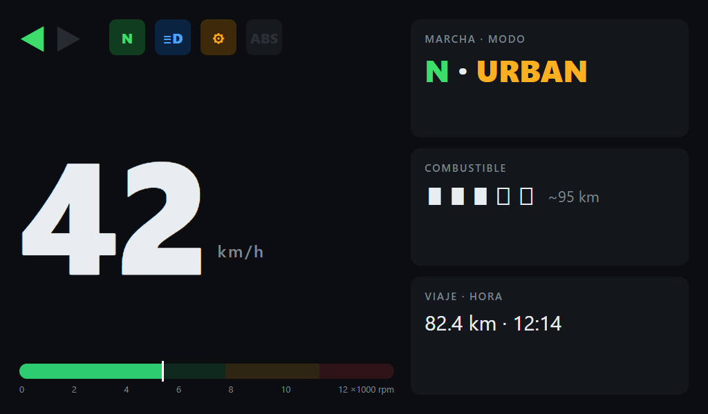
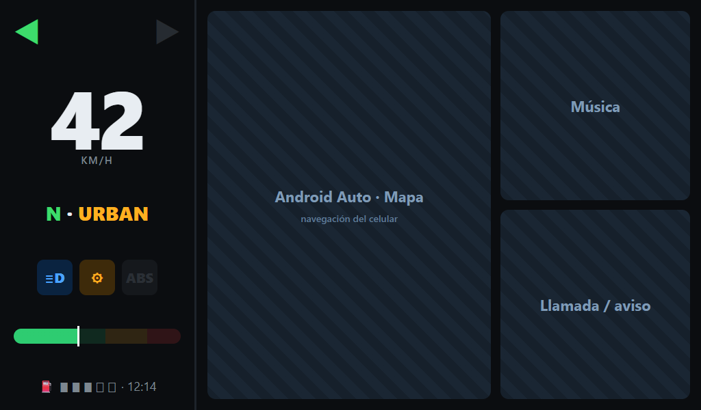
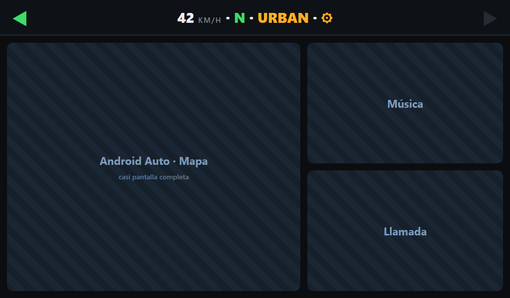
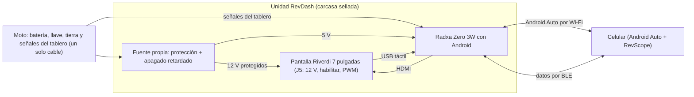

# RevDash

**Un tablero abierto para moto, con Android Auto, hecho en Colombia sobre una TVS Apache RTR 160 4V.**
Arranca con la llave mostrando todo lo que mostraba el tablero de fábrica y, cuando quieres, le da paso
a la navegación y la música del celular. Sin cajas cerradas: código, hardware y carcasa libres.

  
   Maqueta del diseño (no es una captura del producto todavía).

## La historia

El tablero original de la Apache se murió. Tras instalar unas exploradoras con la farola destapada y un
viaje largo bajo lluvia fuerte, primero solo encendía al girar el manubrio a fondo a la izquierda (un
falso contacto en el mazo que pasa por la dirección) y luego no volvió a encender. En vez de repararlo,
RevDash lo reemplaza por un tablero propio: abierto, programable, legible al sol y pensado desde el
primer tornillo para aguantar agua.

## Tres modos de pantalla

<table>
  <tr>
    <td align="center"></td>
    <td align="center"></td>
    <td align="center"></td>
  </tr>
  <tr>
    <td align="center"><b>Tablero completo</b> Al encender o sin celular.</td>
    <td align="center"><b>Tablero fijo + Android Auto</b> La columna del tablero nunca se va; Android Auto con su vista dividida.</td>
    <td align="center"><b>Android Auto casi completo</b> Una franja con velocidad, direccionales, marcha y testigos siempre visible.</td>
  </tr>
</table>

## Qué hace

- 🔑 **Arranca con la llave**, sin depender del celular.
- 🚦 **Todos los testigos** del tablero de fábrica: direccionales, neutro, luz alta, check engine y ABS,
  además de velocidad, RPM, marcha, modo de manejo, combustible, odómetro y trip.
- 🗺️ **Android Auto inalámbrico** con el audio yendo al intercomunicador del casco, no a la pantalla.
- 📡 **Se habla con [RevScope](https://github.com/santiquiroz/revscope) por Bluetooth (BLE)**: se
  complementan cuando el celular está, y cada uno funciona solo cuando no.
- 👂 **Solo escucha a la moto**: nunca le transmite nada a la ECU ni al ABS.
- 🔋 **Consumo cero con la llave apagada**: se apaga limpio y después corta del todo.
- 🔧 **Deja libre el puerto OBD** para diagnóstico y para RevScope.

## Arquitectura

Todo vive en **una sola unidad** (pantalla, placa y fuente en la misma carcasa) con **un solo cable**
hacia la moto.

## Hardware

| Pieza | Para qué |
|---|---|
| **Radxa Zero 3W** (RK3566, Wi-Fi 6, Bluetooth 5.4, con GPIO) | El cerebro: Android 11, el tablero y Android Auto |
| **Riverdi RVT70HSHNWC00-B** (7", 1024×600, 850 nits) | Pantalla legible al sol, con táctil que funciona con guantes y agua |
| **Fuente propia** | Protección contra picos de la moto y apagado retardado sin consumo fantasma |
| **Carcasa en ASA** impresa en 3D | Sellada, con visera, sobre la montura original |
| **ESP32 + analizador lógico USB** (24 MHz, 8 canales) + divisores | Solo para la Fase 0: descubrir qué lleva cada cable del conector ([guía](docs/fase0/)) |

## A prueba de agua

La humedad fue lo que mató el tablero original, así que aquí es requisito de diseño:

- Carcasa cerrada **sin entradas de aire**; el calor sale por una placa trasera de aluminio.
- Vidrio de la pantalla sellado con **junta continua**.
- **Un solo conector automotriz sellado** (Deutsch DT o Superseal, IP67 o mejor).
- **Membrana de ventilación** que iguala presión sin dejar pasar agua, para que no se empañe por dentro.
- Desecante reemplazable y **barniz protector** en las placas.
- Prueba de aceptación: lluvia simulada sin entrada de agua y ciclo de calor y frío sin condensación.

## Hoja de ruta

- [ ] **Fase 0 · Ingeniería inversa** del conector del tablero (en curso): primer pinout público de la Apache.
- [ ] **Fase 1 · Pantalla aparte**: la placa llega hacia el 15 de noviembre de 2026 y la pantalla hacia el 6 de diciembre.
- [ ] **Fase 2 · Reemplazo total**: imagen propia de Android, fuente propia y montaje en la base original.
- [ ] **Fase 3 · Opcional**: dashcam e IA con la NPU de la placa (avisos de colisión, señales, baches).

## Familia Rev

| | RevDash | RevScope |
|---|---|---|
| Dónde vive | En la moto | En el celular |
| Qué lee | El conector del tablero | El puerto OBD |
| Para qué | Ser el tablero | Telemetría, taller y viajes |
| Qué comparte | Direccionales, combustible, modo, odómetro | Datos OBD, GPS, pulso del reloj |

## Documentación

- Diseño completo: [docs/superpowers/specs/2026-10-19-revdash-design.md](docs/superpowers/specs/2026-10-19-revdash-design.md)
- Plan de la Fase 0: [docs/superpowers/plans/2026-10-19-fase0-ingenieria-inversa.md](docs/superpowers/plans/2026-10-19-fase0-ingenieria-inversa.md)

## Contribuir

El proyecto está empezando. Si tienes una moto con tablero muerto, o el pinout del tablero de otro
modelo, abre un issue: cada conector documentado le sirve a alguien más.

## Licencia

[AGPL-3.0](LICENSE). Las piezas compartidas con RevScope se mantienen en Apache-2.0.
