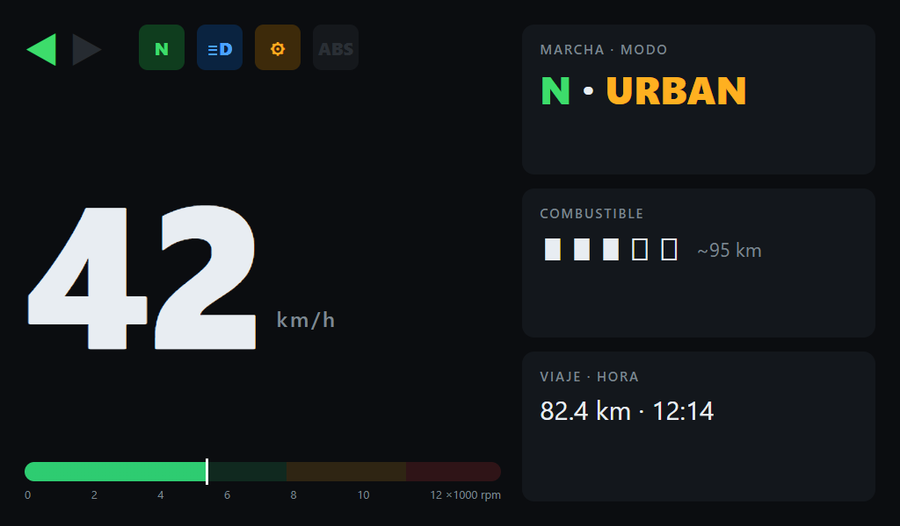
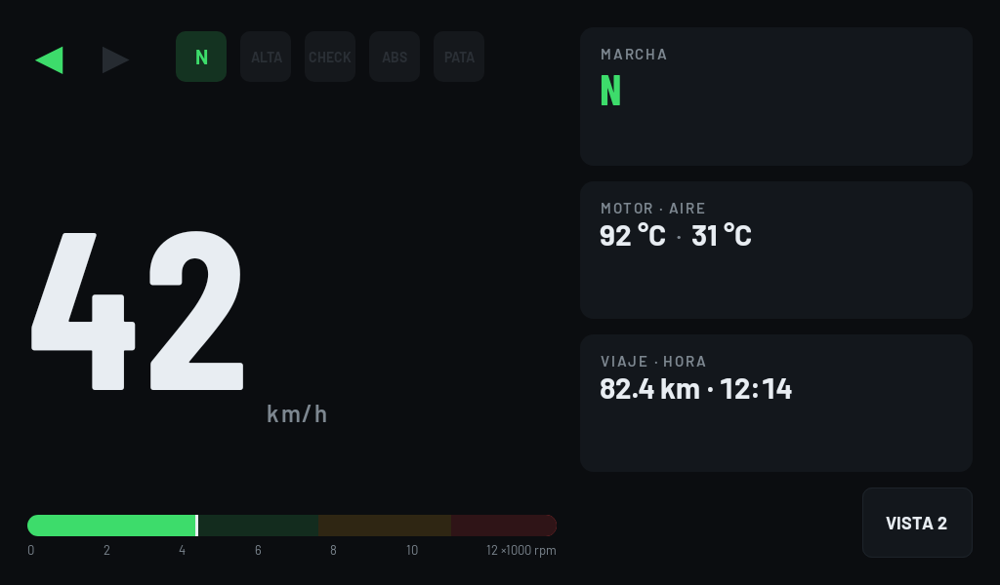
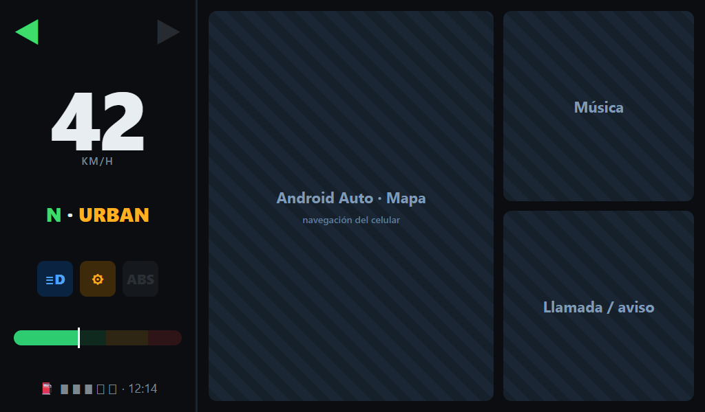
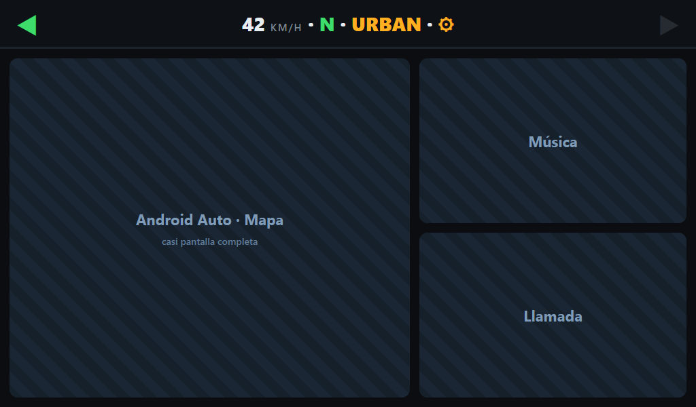
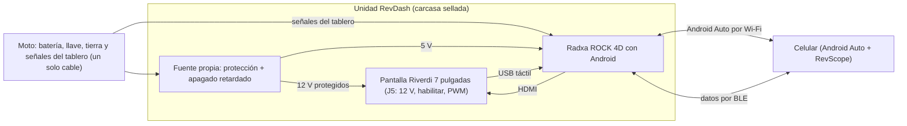

# RevDash

**Un tablero abierto para moto, con Android Auto, hecho en Colombia sobre una TVS Apache RTR 160 4V.**
Arranca con la llave mostrando todo lo que mostraba el tablero de fábrica y, cuando quieres, le da paso
a la navegación y la música del celular. Sin cajas cerradas: código, hardware y carcasa libres.

  
   Maqueta del diseño (no es una captura del producto todavía).

## Estado actual (noviembre de 2026)

La placa y la pantalla llegan en diciembre; mientras tanto, todo lo que se puede construir sin ellas ya corre:

  
   La app real del tablero (captura de la prueba automática a 1024×600).

| Pieza | Qué hace hoy |
|---|---|
| **App del tablero** ([`android/app`](android/app)) | Los tres modos de pantalla. Sin hardware reproduce en bucle una captura CAN real de la Apache; con el ESP32 por USB muestra los datos en vivo. Se ajusta a pantallas más chicas (probada en un celular). |
| **Núcleo** ([`android/nucleo`](android/nucleo)) | Kotlin puro: decodifica el CAN con un perfil por modelo (JSON), odómetro, alertas y el protocolo del ESP32. Probado con capturas reales. |
| **Sonda ESP32** ([`firmware/probe`](firmware/probe)) | Escucha el CAN (solo escucha), cuenta pulsos y reporta las entradas digitales por USB. |
| **Herramientas del PC** ([`tools`](tools)) | Grabar la sonda, calibrar la velocidad contra RevScope y comparar capturas para descubrir señales. |
| **Visión** ([`vision`](vision)) | Detector de objetos (YOLOX, Apache-2.0) sobre videos de ruta, con aceleración por GPU en Windows. Base de la dashcam. |
| **Duplicado de pantalla** ([`android/espejo`](android/espejo)) | Prueba de concepto: la pantalla del celular en el tablero, con táctil. Sin emparejamiento todavía: solo para pruebas. |

### Descargar

En [Releases](https://github.com/santiquiroz/revdash/releases):

- `RevDash-vX.apk`: la app del tablero. En un celular o tablet Android 10+ arranca en modo demostración.
- `RevDash-Espejo-vX.apk`: la app compañera del duplicado (prueba de concepto).
- `revdash-sonda-esp32-vX.bin`: el firmware de la sonda en un solo archivo:
  `esptool.py --chip esp32 write_flash 0x0 revdash-sonda-esp32-vX.bin`.

## La historia

El tablero original de la Apache se murió. Tras instalar unas exploradoras con la farola destapada y un
viaje largo bajo lluvia fuerte, primero solo encendía al girar el manubrio a fondo a la izquierda (un
falso contacto en el mazo que pasa por la dirección) y luego no volvió a encender. En vez de repararlo,
RevDash lo reemplaza por un tablero propio: abierto, programable, legible al sol y pensado desde el
primer tornillo para aguantar agua.

## Tres modos de pantalla

<table>
  <tr>
    <td align="center"></td>
    <td align="center"></td>
    <td align="center"></td>
  </tr>
  <tr>
    <td align="center"><b>Tablero completo</b> Al encender o sin celular.</td>
    <td align="center"><b>Tablero fijo + Android Auto</b> La columna del tablero nunca se va; Android Auto con su vista dividida.</td>
    <td align="center"><b>Android Auto casi completo</b> Una franja con velocidad, direccionales, marcha y testigos siempre visible.</td>
  </tr>
</table>

## Qué hace

- 🔑 **Arranca con la llave**, sin depender del celular.
- 🚦 **Todos los testigos** del tablero de fábrica: direccionales, neutro, luz alta, check engine y ABS,
  además de velocidad, RPM, marcha, modo de manejo, combustible, odómetro y trip.
- 🗺️ **Android Auto inalámbrico** con el audio yendo al intercomunicador del casco, no a la pantalla.
- 📡 **Se habla con [RevScope](https://github.com/santiquiroz/revscope) por Bluetooth (BLE)**: se
  complementan cuando el celular está, y cada uno funciona solo cuando no.
- 👂 **Solo escucha a la moto**: nunca le transmite nada a la ECU ni al ABS.
- 🔋 **Consumo cero con la llave apagada**: se apaga limpio y después corta del todo.
- 🔧 **Deja libre el puerto OBD** para diagnóstico y para RevScope.
- 📱 **Duplicado de la pantalla del celular**, con táctil, para las apps que Android Auto no muestra (en desarrollo).
- 🎥 **Dashcam adelante y atrás** con detección de vehículos y avisos por prioridad (Fase 3).

## Arquitectura

Todo vive en **una sola unidad** (pantalla, placa y fuente en la misma carcasa) con **un solo cable**
hacia la moto.

## Hardware

| Pieza | Para qué |
|---|---|
| **Radxa ROCK 4D** (RK3576, Wi-Fi 6, Bluetooth 5.4, GPIO con CAN) | El cerebro: Android 14, el tablero y Android Auto |
| **Riverdi RVT70HSHNWC00-B** (7", 1024×600, 850 nits) | Pantalla legible al sol, con táctil que funciona con guantes y agua |
| **Fuente propia** | Protección contra picos de la moto y apagado retardado sin consumo fantasma |
| **Carcasa en ASA** impresa en 3D | Sellada, con visera, sobre la montura original |
| **ESP32 + analizador lógico USB** (24 MHz, 8 canales) + divisores | Solo para la Fase 0: descubrir qué lleva cada cable del conector ([guía](docs/fase0/)) |

## A prueba de agua

La humedad fue lo que mató el tablero original, así que aquí es requisito de diseño:

- Carcasa cerrada **sin entradas de aire**; el calor sale por una placa trasera de aluminio.
- Vidrio de la pantalla sellado con **junta continua**.
- **Un solo conector automotriz sellado** (Deutsch DT o Superseal, IP67 o mejor).
- **Membrana de ventilación** que iguala presión sin dejar pasar agua, para que no se empañe por dentro.
- Desecante reemplazable y **barniz protector** en las placas.
- Prueba de aceptación: lluvia simulada sin entrada de agua y ciclo de calor y frío sin condensación.

## Hoja de ruta

- [ ] **Fase 0 · Ingeniería inversa** del conector del tablero (en curso): primer pinout público de la Apache. Si el conector lleva CAN, cada señal se descubre comparando una captura en reposo con otra mientras se acciona el control (direccional, neutro, luz alta…). [Guía de campo](docs/fase0/).
- [ ] **Fase 1 · Pantalla aparte**: placa y pantalla llegan en diciembre de 2026. La app ya corre sin ellas (ver Estado actual).
- [ ] **Fase 2 · Reemplazo total**: imagen propia de Android, fuente propia y montaje en la base original.
- [ ] **Fase 3 · Opcional**: dashcam adelante (CSI) y atrás (USB) e IA con la NPU de la placa (avisos de colisión y punto ciego, señales, semáforos).

## Familia Rev

| | RevDash | RevScope |
|---|---|---|
| Dónde vive | En la moto | En el celular |
| Qué lee | El conector del tablero | El puerto OBD |
| Para qué | Ser el tablero | Telemetría, taller y viajes |
| Qué comparte | Direccionales, combustible, modo, odómetro | Datos OBD, GPS, pulso del reloj |

## Documentación

- Diseño completo: [docs/superpowers/specs/2026-10-19-revdash-design.md](docs/superpowers/specs/2026-10-19-revdash-design.md)
- Plan de la Fase 0: [docs/superpowers/plans/2026-10-19-fase0-ingenieria-inversa.md](docs/superpowers/plans/2026-10-19-fase0-ingenieria-inversa.md)
- App del tablero: [docs/superpowers/specs/2026-11-04-app-revdash-design.md](docs/superpowers/specs/2026-11-04-app-revdash-design.md) y reglas visuales en [docs/diseno/sistema-visual.md](docs/diseno/sistema-visual.md)
- Duplicado de pantalla: [docs/superpowers/specs/2026-11-04-duplicado-pantalla-design.md](docs/superpowers/specs/2026-11-04-duplicado-pantalla-design.md)
- Cámaras e IA: [docs/investigacion/camaras-ia.md](docs/investigacion/camaras-ia.md); pantallas: [docs/investigacion/pantallas.md](docs/investigacion/pantallas.md)

## Contribuir

El proyecto está empezando. Si tienes una moto con tablero muerto, o el pinout del tablero de otro
modelo, abre un issue: cada conector documentado le sirve a alguien más.

## Licencia

[AGPL-3.0](LICENSE). Las piezas compartidas con RevScope se mantienen en Apache-2.0.
